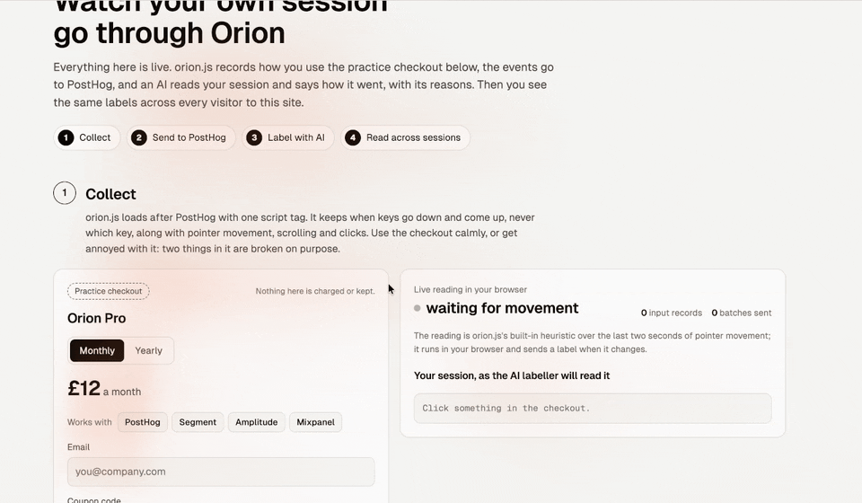
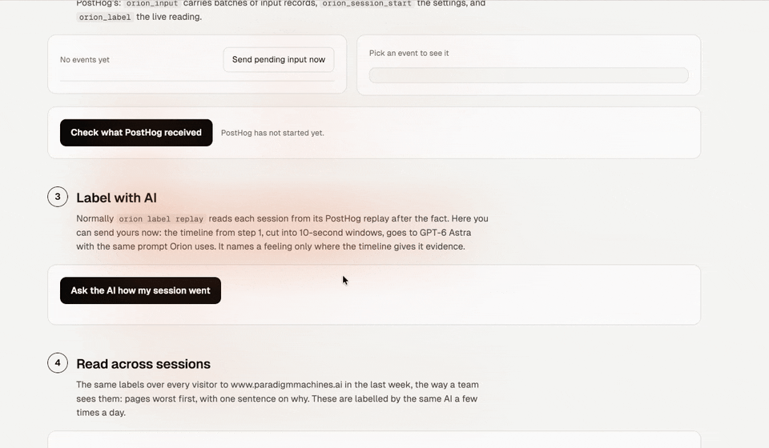

<h1 align="center">Gaze Live</h1>

<h3 align="center">A live heatmap of where you're looking, drawn over your screen. No webcam.</h3>

<p align="center">
  <a href="LICENSE"></a>
  <a href="https://github.com/ryanlin10/orion-gaze-live/actions/workflows/ci.yml"></a>
</p>

<p align="center">
  
  <br>
  <sub>Going through a practice checkout. The heat moves to each field and button as it is used.</sub>
</p>

<p align="center">
  
  <br>
  <sub>Asking the AI, then scrolling down to read the answer.</sub>
</p>

<p align="center"><sub>A real person on a real page, replayed through the live API at real speed: the heat is what Gaze Live
drew, about 0.2 s behind, at the strength the model is sure of. The arrow is their pointer.</sub></p>

Gaze Live streams your screen and your input (pointer, clicks, scrolling, and the fact that a key was pressed) to
[Orion's Gaze API](https://app.paradigmmachines.ai/docs/gaze-api), and draws the gaze it predicts back over your
screen about ten times a second. The model learned from hundreds of hours of eye tracking on screens, so it reads what
is on screen and what you are doing the way people's eyes follow them. Gaze is predicted, not measured.

## Requirements

- macOS 14 (Sonoma) or later
- An Orion API key: sign in at [app.paradigmmachines.ai](https://app.paradigmmachines.ai), press your profile
  picture, then API, then Create API key

## Install

With [uv](https://docs.astral.sh/uv/) (it fetches a suitable Python if you don't have one):

```sh
curl -LsSf https://astral.sh/uv/install.sh | sh
uv tool install git+https://github.com/ryanlin10/orion-gaze-live
```

Or with pipx and Python 3.10+: `pipx install git+https://github.com/ryanlin10/orion-gaze-live`.

## Run

```sh
gaze-live
```

The first run asks for your API key, checks it and saves it to `~/.config/gaze-live/api-key`, readable by you only.

macOS then asks for two permissions for the app you ran it from (Terminal, iTerm, VS Code and so on). Allow them in
System Settings, Privacy & Security, then quit and reopen that app and run `gaze-live` again:

| Permission | Needed for |
| --- | --- |
| Screen & System Audio Recording | The screen pictures. Required: there is no gaze without them. |
| Input Monitoring | Key presses and scrolling. Optional: without it, only the pointer and clicks are read. |

The heatmap appears once the first map arrives. When no GPU is running, starting one takes about two minutes; the
status says so meanwhile. After that, maps arrive about ten times a second, each 100 to 200 ms behind your input.

Everything else is in the ○ Gaze item in the menu bar: the status, Stop and Start, the model, Show heatmap, and
Quit. Ctrl-C in the terminal quits too, and ends the stream cleanly.

The heatmap is brightest where the model is surest: its maps are calibrated, so an opaque blob is usually right and a
faint, spread-out one is a guess (as it often is when the pointer is still and the screen hasn't changed for a while).

## Options

| Option | What it does |
| --- | --- |
| `--model gaze-base` | Use the backfill model instead of `gaze-live`, the realtime one (the default). |
| `--rate N` | Maps a second, 1 to 20. Default 10. |
| `--grid 32x20` | A coarser map. Default 64x40. |
| `--print` | Also print every gaze point to stdout as a JSON line: `{"t", "x", "y", "on_screen"}`, t in Unix ms (the API's clock), x and y in screen points. |
| `--check [SECONDS]` | Test your key and the connection with a synthetic screen and pointer, then exit. Needs no permissions and works on any OS. |
| `--set-key` | Save a new API key (or pipe one in: `echo $KEY \| gaze-live --set-key`). |

`ORION_API_KEY` in the environment takes precedence over the saved key.

## Use the stream in your own code

`gazelive.stream.GazeStream` is the whole client: one class, no macOS needed. Send it pictures and input from
anything (a game, a video, a robot's camera); it reconnects by itself and keeps the newest map.

```python
from gazelive.stream import GazeStream

stream = GazeStream(api_key, screen=(1440, 900)).start()
stream.on_gaze = lambda g: print(g.x, g.y, g.on_screen)   # called for every map, on the stream's thread

stream.picture(jpeg_bytes)      # whenever the screen changes; it sends at most one a second, the newest
stream.move(640, 300)           # pointer position, in the units of `screen`
stream.down(640, 300); stream.up(640, 300)
stream.scroll(1200)             # scroll position, growing as the page goes down
stream.key()                    # a key was pressed (never which)

stream.gaze.map                 # [40, 64] chance the gaze is in each cell; sums to stream.gaze.on_screen
stream.close()                  # ends the stream, so it stops counting toward your limits
```

The wire protocol is in the [API reference](https://app.paradigmmachines.ai/docs/gaze-api), under Real time.

## What leaves your Mac

- Pictures of your main display, 1024x640 JPEG, only when something on it changed and at most one a second. Gaze
  Live's own heatmap is left out of them. Anything else on screen is in them: press Stop before showing something
  you'd rather not send.
- Pointer positions, button presses and releases, scroll positions, and that a key was pressed. Never which key.

They go over TLS to `api.paradigmmachines.ai`, are read by GPUs in AWS Ireland (eu-west-1), and nothing a stream
carries is kept: only its counts are written, for your usage. Your API key is sent only to the API.

## Limits

Each account can stream 240 minutes a day (reset at midnight UTC), with 2 streams open at once. A stream lasts up to
60 minutes; Gaze Live then opens a new one by itself. An open stream counts its minutes even while you're idle, so
press Stop when you're not using it. Your usage is on the API page of your account. To raise the limits, email
ryan@paradigmmachines.ai.

## Troubleshooting

| You see | What to do |
| --- | --- |
| Waiting for a GPU | Normal for about two minutes when none was running. |
| Allow Screen Recording, then restart gaze-live | Allow it for your terminal app in System Settings, quit and reopen the terminal. |
| Input: pointer and clicks only | Allow Input Monitoring for your terminal app, then reopen it, for keys and scrolling. |
| Stopped: the API refused this key | The key was revoked or mistyped: make a new one and run `gaze-live --set-key`. |
| Stopped: … minutes for today | The day's 240 minutes are used up; they reset at midnight UTC. |
| This account has 2 streams open | Quit another Gaze Live. A stream that wasn't closed (a crash, a lost connection) ends by itself within a few minutes. |
| The heatmap is on the wrong screen | Gaze Live reads and draws on the main display only: the one with the menu bar. |

Run `gaze-live --check` to tell a key or network problem from a permission problem.

## Development

```sh
git clone https://github.com/ryanlin10/orion-gaze-live && cd orion-gaze-live
uv venv && uv pip install -e '.[test]'
.venv/bin/pytest             # offline: the stream is tested against a local stand-in for the API
```

| File | What it holds |
| --- | --- |
| `gazelive/stream.py` | The API client: WebSocket, reconnects, map parsing. |
| `gazelive/capture.py` | macOS input tap and ScreenCaptureKit pictures. |
| `gazelive/heatmap.py` | Map to overlay picture: smoothing and opacity. |
| `gazelive/app.py` | The overlay window and the menu-bar item. |
| `gazelive/cli.py` | `gaze-live`: options, key setup, `--check`. |

## License

[MIT](LICENSE)
